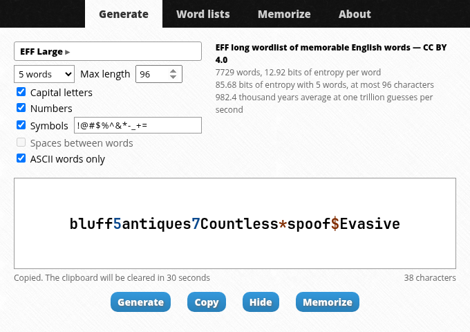
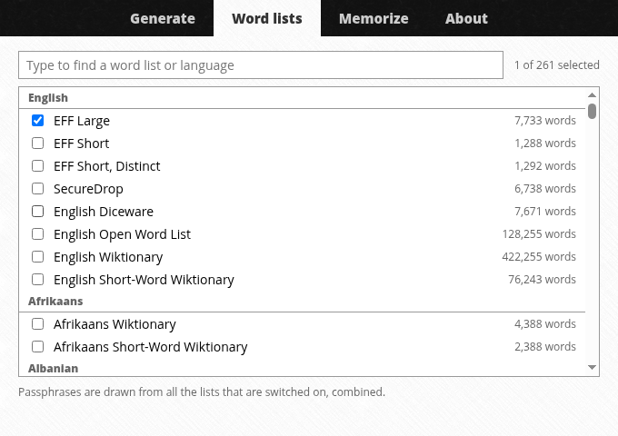
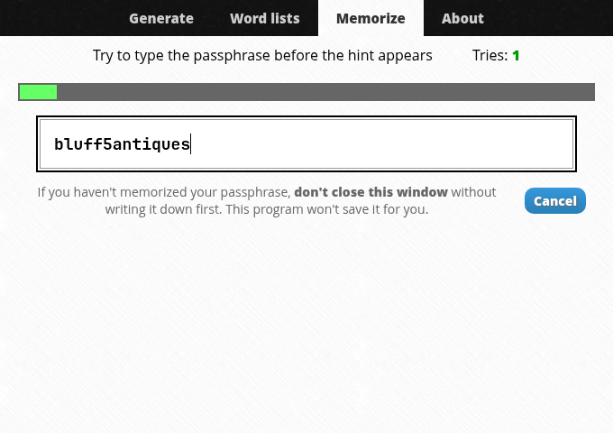
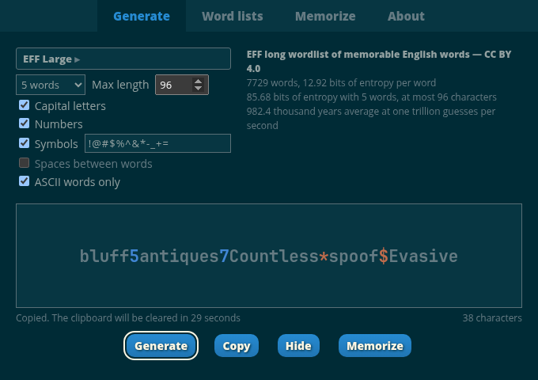
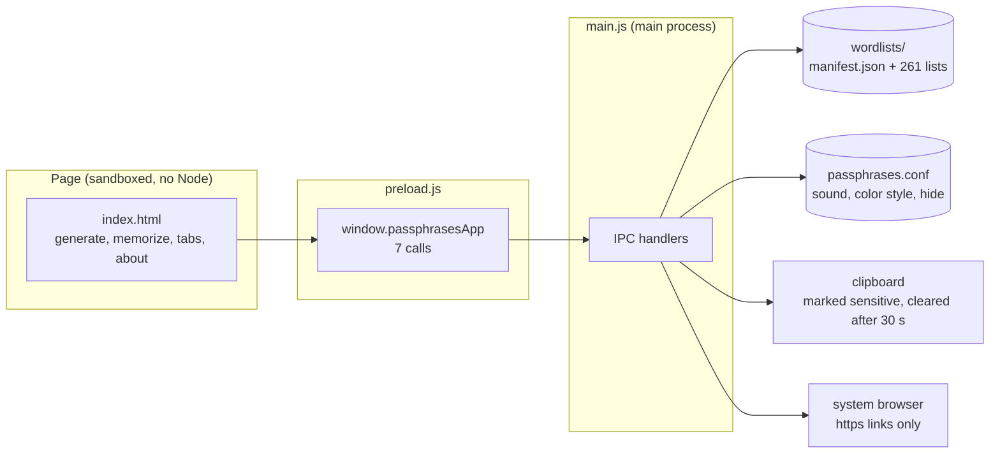
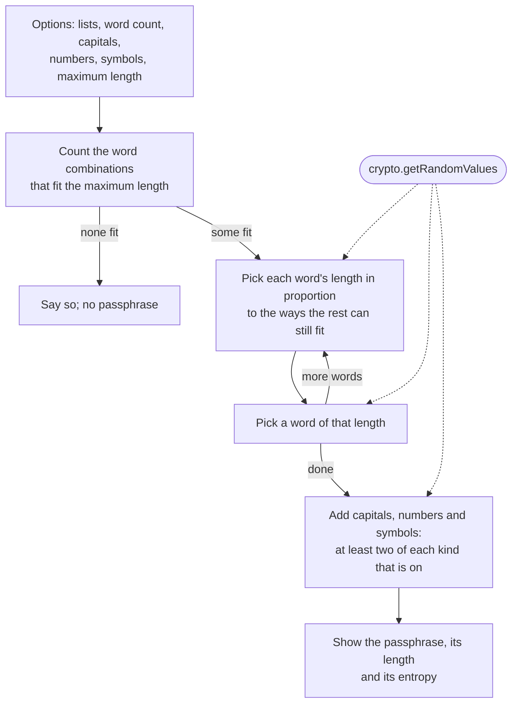
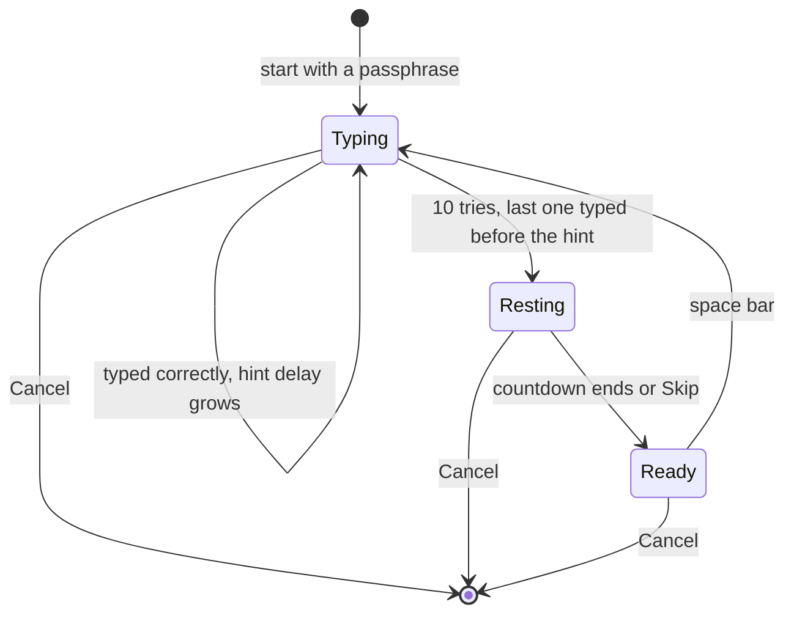
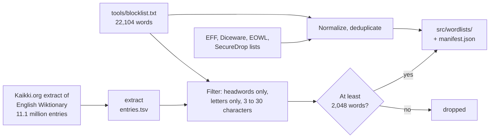
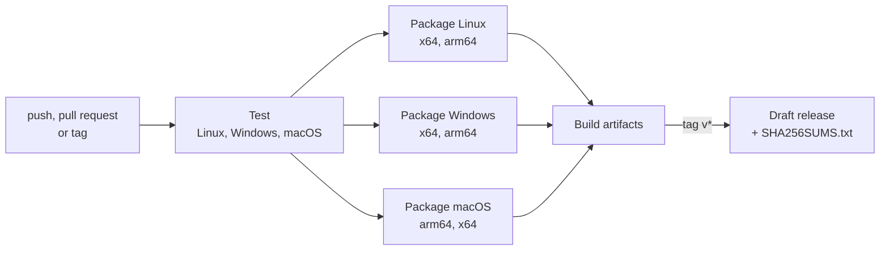

<p align="center"></p>

# Passphrases

[](https://github.com/StephenGenusa/passphrases/actions/workflows/build.yml)
[](https://github.com/StephenGenusa/passphrases/releases)
[](LICENSE.md)


A desktop tool that generates high-entropy passphrases and helps you memorize them with spaced repetition.

<p align="center">
  
  
</p>
<p align="center">
  
  
</p>

## Features

- **Random where it counts.** Words are drawn with the operating system's cryptographic random number generator, with no modulo bias.
- **261 word lists in 137 languages.** They are built from Wiktionary, plus the EFF, Diceware, EOWL and SecureDrop lists. The Word lists tab groups them by language with English first, and typing narrows them down.
- **Mix lists.** Switch on more than one and passphrases are drawn from all of them combined.
- **Clean lists.** A single list of 22,104 slurs and vulgar words, covering all languages, is filtered out of every list.
- **A maximum length that is honoured exactly.** Every passphrase that fits is equally likely, and the entropy shown is the real figure for that limit.
- **Made for sites with password rules.** Capital letters, numbers and symbols are each a checkbox, and every kind that is on appears at least twice. The symbols come from a field you can edit to match what a site accepts; it starts with the commonly accepted ones.
- **ASCII words only, by default.** Words with accented or non-Latin letters are left out unless you switch that off, because many sites mishandle them.
- **Fourteen color styles.** They include low-contrast ones that draw the passphrase at about 3:1 contrast, readable at the keyboard and hard to read from across a room.
- **A copy button that cleans up after itself.** The passphrase is put on the clipboard with the markers password managers use, so Windows clipboard history, cloud clipboard sync and clipboard managers skip it. The app clears it from the clipboard after 30 seconds, unless you have copied something else by then. Closing the window does not cancel the clearing.
- **Hide and show.** One button turns the passphrase into dots, and the choice is remembered.
- **Hard to misread.** The passphrase is set in JetBrains Mono, which keeps l, I and 1 and O and 0 apart, and digits and symbols each have their own color. The font ships inside the app.
- **Works from the keyboard.** Every button and tab can be reached with Tab and the arrow keys, and is labelled for screen readers.
- **Private.** Nothing is saved except the sound, color and hide settings. The main process cancels every network request, so nothing is sent over the Internet.

## Download

Installers are built by GitHub Actions and attached to each [release](https://github.com/StephenGenusa/passphrases/releases).

| Platform | Files |
|---|---|
| Linux x64 and arm64 | `.AppImage`, `.deb`, `.rpm`, `.tar.gz` |
| Windows x64 (win64) and arm64 | `-Setup.exe` installer, portable `.zip` |
| macOS Apple silicon and Intel | `.dmg`, `.zip` |

- **No 32-bit Windows build.** Electron no longer ships one, so win32 is not available.
- **The installers are not code signed.** Windows SmartScreen and macOS Gatekeeper will warn before the first run. On macOS, right-click the app and choose Open.
- **Checksums.** Each release includes `SHA256SUMS.txt`.

## No dependencies beyond Electron

The app ships with **zero npm packages**. Everything on the page is plain HTML, CSS and JavaScript, about 1,100 lines in all.

- **jQuery was removed.** The original app used jQuery 2.1. It was replaced by the browser's own DOM calls and two small helper functions in `src/js/common.js`: `el()` finds an element and `setVisible()` shows or hides it. No library took its place.
- **random-js was removed.** Its default engine was `Math.random`, which is not suitable for secrets. A short function over `crypto.getRandomValues` replaced it.
- **Two fonts are bundled as files.** Open Sans for the interface and JetBrains Mono Bold for the passphrase, both under open licences kept beside them in `src/fonts`. They are loaded from disk, never from the network.
- **Electron is the only development dependency.** It brings 12 small packages used to download and unpack it; none of them is in the packaged app. `package-lock.json` pins every version.
- **No build framework.** `build.js` packages the app with Node and each platform's own tools. In CI, two extra tools are downloaded (appimagetool and rcedit), each pinned to a version and checked against a SHA-256 checksum, and every GitHub Action is pinned to a commit.

## How it works

### Architecture

The page runs in Chromium's sandbox with no access to Node or the file system. It reaches the rest of the system only through seven calls that the preload script exposes.



A Content-Security-Policy allows only the app's own files, the main process cancels any request that is not for one of those files, and the page asks for a word list by id; the file name always comes from the manifest in the main process.

### Generating a passphrase



Counting first is what makes every fitting passphrase equally likely, and the logarithm of that count is the entropy the app displays.

### Memorizing



The hint appears later on each try, the field turns into a password field after five tries, and the rests grow from one minute to an hour. A notification says when a rest is over.

### Building the word lists



### Continuous integration



## Run from source

```sh
git clone https://github.com/StephenGenusa/passphrases.git
cd passphrases
npm install
npm start
```

`npm test` starts the app and drives the window end to end. See [BUILD.md](BUILD.md) for packaging, the icon and rebuilding the word lists.

## Credits and license

Passphrases is a fork of [micahflee/passphrases](https://github.com/micahflee/passphrases) by Micah Lee, released under the [MIT license](LICENSE.md).

Word lists: [Wiktionary](https://www.wiktionary.org/) via [Kaikki.org](https://kaikki.org/) (CC BY-SA), the [EFF wordlists](https://www.eff.org/dice) (CC BY 4.0), the Diceware lists and their translators, the English Open Word List, and SecureDrop. The blocklist draws on [LDNOOBW](https://github.com/LDNOOBW/List-of-Dirty-Naughty-Obscene-and-Otherwise-Bad-Words) (CC BY 4.0). Color palettes: Solarized, Nord, Gruvbox, Dracula and Zenburn.
